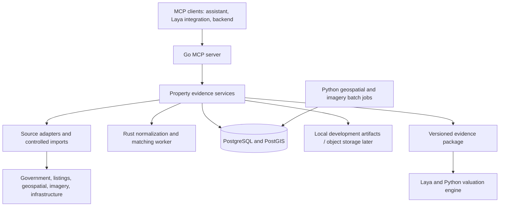

# PRISM Property Intelligence MCP: purpose and build plan

Current delivery scope: **Baner and Kharadi residential apartments, Pune**. The Go stdio MCP exposes 14 tools, with Rust matching, rule-based comparable selection, Python-backed Overture amenities, MahaRERA lookup, an importer, immutable evidence packages and a Next.js viewer. Local Firecrawl supports automatic source discovery, bounded index-link expansion and ingestion by saved candidate IDs without a manual domain list. One real Baner asking-price record was verified; this is not a completed-sale or valuation dataset. Synthetic examples use a separate store. See [PUNE_DEMO.md](PUNE_DEMO.md) for the runnable demo and its limits. The national architecture below is an expansion design, not the current data coverage or build priority. PostgreSQL/PostGIS, other state adapters, satellite features and a validated valuation model remain future work.

## 1. Purpose

Build a reusable Model Context Protocol (MCP) server that turns fragmented Indian property records into a structured, traceable evidence package. An MCP client can discover its tools, submit a property query, retrieve comparable evidence and location context, and inspect where each fact came from.

The engineering contribution is the source integration, property reconciliation, evidence model, and reproducible processing exposed through MCP. MCP supplies the interface; the underlying pipeline performs the actual data work.

Primary users:

- PRISM's Laya layer, which can evaluate evidence and comparable candidates.
- The Python valuation pipeline, which consumes structured attributes and evidence.
- An AI assistant using an MCP client to investigate a property.
- A future lender-facing Next.js interface, through a server-side MCP client or a thin API using the same domain services.

Success means: given a property query anywhere in India, resolve its jurisdiction, report actual source coverage, and return available property/project records, candidate comparable records, geographic features, source provenance, and unresolved issues in a machine-readable package. A valid Indian location can have partial or unavailable evidence; accepting a location does not imply complete records or a reliable valuation.

This scope supplies the foundation for points 1 and 2 of the Hero Housing challenge. The overall team still needs the valuation model, evaluation, explanations, scaling evidence, and lending workflow required by the other four points.

## 2. Market scope

Long-term product scope: all India. The current pilot is limited to Baner/Kharadi apartments; add cities only after source access, data quality and the end-to-end flow are verified. National jurisdiction routing and coverage reporting already exist. Shared residential/commercial classifications support later expansion; each evidence tool must report actual support by location and property type.

Use a national routing hierarchy: country -> state/union territory -> district -> city/local body -> locality/village -> property or project. Support rural locations without requiring a city. Store names and aliases in their original script alongside normalized search forms; preserve ambiguity and source administrative identifiers where available.

Implement national geographic context and the source registry first, then add state-specific registration, reference-rate and RERA adapters. Maharashtra/Pune is one validation case, alongside locations in other states and at least one rural location. This is a national product built through incremental source integration, with no claim of uniform transaction access.

Accept address/project information and, when available, coordinates, unit details, area with its measurement basis, and a valuation date. A project-level match must never imply that a particular apartment unit has been identified.

Scope is machine-readable: jurisdiction boundaries, supported property types, source coverage, freshness, and connector availability are returned by `get_market_coverage`. Results distinguish supported, partial, not yet integrated, source unavailable, and unsupported property type. Do not substitute another state's reference rates or infer that an empty search proves no records exist.

Extending evidence coverage within India requires more than another scraper:

1. Add state/city source adapters and check access and reuse permissions.
2. Add address aliases, administrative boundaries, local reference-rate mappings, and unit conventions.
3. Evaluate matching and coverage on representative urban and rural samples in that jurisdiction.
4. Publish the resulting coverage and limitations.

Commercial is part of the national evidence schema: support office/shop classifications, lease and rent evidence, occupancy, operating expenses where available, and separate comparable pools. Stage the specialized connectors according to access and explicitly report unsupported evidence. Cap rates must carry their source and assumptions. Commercial valuation belongs to the downstream model and must not reuse apartment assumptions silently.

## 3. Architecture and technology ownership



| Technology | Responsibility | When introduced |
| --- | --- | --- |
| Go | MCP transport, tool schemas, orchestration, adapters, persistence, rate limits, cache | First milestone |
| PostgreSQL + PostGIS | Source records, evidence lineage, property identities, geographic queries, package snapshots | First evidence pipeline |
| Rust | Address tokenization, duplicate candidate matching, explainable reconciliation rules | After the first retrieval path works |
| Python | Satellite/geospatial batch processing and downstream valuation integration | Geospatial extension; model outside this scope |
| Next.js + React + TypeScript | Evidence explorer and lender interface | After the MCP acceptance demo |

The Go services include a jurisdiction resolver and source router. They select applicable national/state/local adapters using geography, property type, evidence category and source capability. Adapters advertise where and how they work; no city-specific logic belongs in MCP tool handlers.

Use the official Go SDK: `github.com/modelcontextprotocol/go-sdk/mcp`. Start with stdio for local development and client integration. Add Streamable HTTP for remote clients after the local workflow works, using the SDK's supported protocol negotiation rather than hand-implementing JSON-RPC.

Keep domain services independent of MCP handlers so the importer, CLI, future API, and tests use the same logic. Start with one Go process. Integrate Rust as a local JSON-lines subprocess with a versioned request/response contract and explicit timeouts; a permanent network service is unnecessary initially.

Pin SDK and library versions when implementation starts. Log to stderr for stdio transport; stdout is reserved for MCP protocol messages.

## 4. Source strategy and feasibility gate

Government portal existence is not proof of a public API, reusable bulk data, or usable valuation labels. Source access must be established before building a connector around it.

| Source family | Intended evidence | Access decision and limitation |
| --- | --- | --- |
| IGR Maharashtra / authorized transaction extracts | Registered consideration, transaction date, location and attributes actually present | Verify accessible records, terms, field availability, permitted storage and retrieval method. Use authorized import if automated access is unavailable. Do not bypass login or CAPTCHA. |
| MahaRERA | Project registration, identity, address, status, disclosed project attributes | Verify actual fields and reuse conditions. Do not assume launch prices or unit sale prices exist. |
| Government reference rates | Reference-rate context by location, date and property category | Verify geographic mapping and effective dates. Reference rates are distinct from completed-sale prices. |
| Permitted listings / Firecrawl | Asking-price context and property descriptions | Firecrawl is a retrieval mechanism, not permission to collect a website. Retain listing timestamps and deduplicate. |
| OSM or another permitted geographic provider | POIs, transport, road and geographic context | Record data snapshot, licensing/attribution and provider limits. Choose permitted hosted or local extraction; do not assume unrestricted public endpoints. |
| Sentinel-2 or another suitable imagery source | Neighborhood vegetation/built-up proxies and change features | Record acquisition date, cloud handling, resolution, buffer and algorithm. These are neighborhood proxies, not unit condition measurements. |
| Official infrastructure documents | Announced, under-construction and operational transport/road context | Record announcement date, status, location precision and source. Never turn an announced project into an operational amenity. |

IGR Maharashtra and MahaRERA above are examples of state connectors. The national registry must also represent other states/union territories and their registration, reference-rate and RERA sources, with integration status and verified capabilities. A single government-record connector cannot be assumed to work across India.

Maintain a source registry with: source ID, owner, access mode, permissions reference, attribution, supported geography, fields, refresh policy, last successful retrieval, and enabled/blocked status.

Each adapter implements the relevant capabilities only: discovery, retrieval/import, normalization, and health/coverage reporting. Some sources may support imports but no live search. Advertise that difference.

First source milestone: national jurisdiction/coverage routing plus a geographic adapter capable of querying Indian locations, and a usable property/project adapter with documented access. Validate routing across multiple states and rural/urban locations. Expand to working property/project adapters in at least two states for the core MVP; this is an implementation acceptance target, not a claim of current access. Continue transaction access investigation without representing project data as sale labels.

If transaction data cannot be obtained, the MCP can still demonstrate project and listing intelligence, but it must return `transaction_evidence_unavailable`. The team cannot claim validated sale-price accuracy from that package.

## 5. Canonical evidence model

Separate source records, observations, identity links, and derived features. Preserve conflicting observations instead of overwriting them into an apparently certain property record.

### Property query

- Country (India), state/union territory, district, optional city/local body, locality/village and property type. Derive missing jurisdiction fields from coordinates or candidate addresses when possible and retain uncertainty.
- Original address, project/building, locality, PIN code and optional unit identifier.
- Optional coordinates with origin and precision.
- Area value, unit, and basis: carpet, built-up, super built-up, or unknown.
- Optional attributes such as bedrooms, floor and construction year.
- Effective date (`as_of`) and freshness requirements.

### Source record and observations

- Stable internal record ID and provider record ID, when available.
- Source ID, URL or authorized import reference, content hash, parser version.
- Source event/publication date, retrieval time and import time as separate fields.
- Raw reference and field-level observations with units, meaning and provenance.
- Price type: registered consideration, asking price, government reference rate, rent, or unknown.
- Area basis and original units. Normalize sq m/sq ft with a documented conversion; do not infer carpet-to-built-up ratios.
- Validation errors, freshness, access mode and data mode: live, imported, or synthetic fixture.

### Reconciliation and derived features

- Candidate identity, entity level (unit/building/project/locality), match method and reasons.
- Accepted, rejected and ambiguous identity links; preserve original records.
- Duplicate clusters distinguished from multiple legitimate transactions for the same unit.
- Feature name, value, unit, method/version, source IDs, buffer geometry and effective date.
- Geocode precision, ambiguity and candidate locations.
- Conflict flags with affected observations and resolution status.

### Evidence package

- Package ID, schema version, creation time, query and effective date.
- Subject attributes with selected observations and selection reasons.
- Candidate comparables, geographic features and infrastructure evidence.
- Source coverage: available, missing, failed, stale and out-of-scope.
- Quality components and rule version; any aggregate score is an evidence-quality heuristic until validated.
- All warnings and identity/geocoding limitations.
- Record references, feature versions, configuration and pipeline version needed for reproducibility.

Evidence quality is distinct from Laya decision confidence and a valuation model's price interval.

For historical queries, filter by both event date and when information became available. Present-day listings or satellite features cannot enter a historical package unnoticed. An old deed imported today needs a documented basis for historical availability; otherwise disclose that limitation or exclude it under strict historical mode.

## 6. Initial MCP interface

Return typed, structured results with a concise text summary. Bound response sizes, paginate evidence lists, and reference stored artifacts for raw content. Do not send entire scraped pages to the model by default.

| Tool | Input | Output |
| --- | --- | --- |
| `get_market_coverage` | Location/jurisdiction or coordinates, property type; optional national summary | Jurisdiction, coverage boundary, enabled sources/capabilities, integration status, access mode, freshness, gaps |
| `resolve_property` | Address/project, optional coordinates and attributes | Normalized query, candidate identities/locations, precision, ambiguity and required fields |
| `search_property_evidence` | Resolved query, evidence types, date filters, cursor | Paginated source-backed records, conflicts, source failures and missing categories |
| `find_comparables` | Subject, price type, area basis, distance/time limits, result limit | Comparable candidates with differences, selection reasons and explicit exclusions |
| `get_location_context` | Coordinates, bounded buffer, effective date | Dated POI distances, imagery/infrastructure features and provenance |
| `build_evidence_package` | Query or resolved subject, effective date, selected source types | Stored package reference, structured package summary, completeness and warnings |
| `get_evidence` | Evidence or package ID, bounded detail level | Stored evidence, lineage and reproducibility metadata |

`build_evidence_package` orchestrates the same services as the individual tools. It uses bounded concurrency and a request deadline; it returns partial results explicitly when individual sources fail. Durable source refreshes and bulk imports run through an administrative CLI initially, not an unrestricted agent-facing write tool.

Candidate comparables are selected using transparent rules first: property type, geography, date, area basis and attributes. Keep asking-price and registered-sale pools distinct. Location-only similarity is insufficient to identify the same physical apartment.

MCP resources can expose the source registry and coverage guide plus saved package/evidence documents, subject to the same access checks as tools. Resource availability alone does not grant access.

## 7. End-to-end request

1. Client submits an Indian location or coordinates and checks jurisdiction/property-type coverage.
2. Client submits a property query with explicit area basis and effective date.
3. Server normalizes input and resolves candidate locations; ambiguous geocodes remain ambiguous.
4. Server routes to applicable national, state and local adapters and retrieves cached or permitted fresh evidence.
5. Raw records are stored/referenced, parsed and normalized with lineage.
6. Rust reconciliation identifies candidate duplicates, conflicts and identity links with reasons.
7. Server retrieves comparable candidates and dated location context.
8. Server snapshots the evidence package and reports missing/failed sources.
9. Laya and the valuation team consume the package and preserve its ID in their results.

Cache keys include query, effective date, source/parser versions, permissions scope and freshness policy. Repeating a request against the same saved snapshot should reproduce the normalized package apart from request metadata. A deliberate refresh creates a new snapshot.

## 8. Reliability and access controls

- Connector-specific concurrency limits, timeouts, retry budgets and cache policies.
- Explicit outcomes: invalid input, unsupported market, ambiguous property, source unavailable, rate-limited, no evidence, partial success.
- Server-controlled source endpoints and bounded parameters; no unrestricted URL-fetch tool.
- Treat source documents as data, including any instructions embedded in their text.
- Keep API keys in environment/secret configuration and out of tool output and logs.
- Limit stored/exposed personal details to those needed for the property evidence use case.
- For remote HTTP, implement authentication, authorization, origin/host checks and tenant isolation before exposing stored records. Apply MCP authorization requirements when providing third-party remote-client access.
- Store request IDs, source outcomes, durations, cache outcomes and package IDs for diagnosis.

These controls are part of a usable server, not evidence that the system is approved for lending or performs legal title verification.

## 9. Build milestones and acceptance gates

### Milestone 1: contract and runnable MCP skeleton

Deliver Go entry point, SDK dependency, stdio transport, typed query/result schemas, national jurisdiction/source routing, `get_market_coverage`, `resolve_property`, configuration and a source-access register. Add fixture records explicitly labeled synthetic for protocol development. Coverage queries must work for all states/union territories even when source integration is pending.

Acceptance: a real MCP client initializes, discovers tools, invokes them, receives schema-valid results, and gets a clear unsupported/ambiguous response when appropriate.

### Milestone 2: first real evidence flow

Deliver PostgreSQL/PostGIS schema, controlled importer, first usable property/project adapter, geographic adapter, raw record references, `search_property_evidence`, and `get_evidence`.

Acceptance: queries in at least two states return real property/project evidence and independent geographic context with field-level lineage and access documentation. Test a rural location and a jurisdiction with no integrated property source: both receive accurate coverage outcomes. One connector failure produces a partial result. Imported and live records are distinguishable.

### Milestone 3: reconciliation and comparable retrieval

Deliver Rust worker contract, normalization/matching rules, conflict preservation, dedup clusters and `find_comparables`.

Acceptance: evaluate on manually reviewed address/match pairs including different units in the same building, repeated sales, spelling variations, conflicting areas and duplicate listings. Report false merges and missed matches. Measure comparable relevance on a reviewed sample rather than claiming a confidence score proves accuracy.

### Milestone 4: consolidated package and geographic enrichment

Deliver package snapshots, `build_evidence_package`, `get_location_context`, as-of handling and bounded caching. Add imagery and infrastructure features only with a working dated data pipeline; disclose unsupported features.

Acceptance: a client builds and rereads packages for locations in different states, with no cross-state source contamination; historical filtering excludes later information; a saved snapshot reproduces; all displayed derived features reference their inputs and methods.

### Milestone 5: remote integration and handoff

Deliver Streamable HTTP, required access controls, client setup examples, documentation, container setup and Python package-consumer example. A small evidence explorer can follow.

Acceptance: another machine/client discovers tools and retrieves an authorized package. Unauthorized access is denied. Cancellation/timeouts terminate connector work appropriately. Complete a smoke test over both transports.

## 10. Verification and measurement

Use meaningful unit and integration tests for schema validation, unit/price semantics, ambiguous matching, temporal filtering, lineage and connector failure behavior. Use fixtures for reproducible CI; keep separately labeled live-source checks optional and respectful of limits.

Report actual measurements for:

- Source coverage, record counts and missing-field rates by source.
- Coverage by state/union territory, district, urban/rural location, property type and evidence category; distinguish routing support from real record availability.
- Matching precision/recall on a reviewed set, sample size and false merges.
- Comparable relevance on a reviewed set.
- Provenance completeness and reproducibility checks.
- Cold versus warm latency, p50/p95, source timeout rates and cache hit rate.
- Partial result rate and source age.
- Serialized package size, with compact summaries versus full details.

Set performance targets only after measuring the first pipeline. A successful cached demo is not evidence of live-source turnaround. MCP evidence-quality results do not establish valuation-model accuracy.

## 11. Proposed repository layout

```text
cmd/prism-mcp/             Go MCP executable
cmd/prism-admin/           Authorized import and source refresh CLI
internal/domain/          Canonical evidence types and validation
internal/mcp/             Tool/resource handlers and transport wiring
internal/adapters/        Source registry, imports and provider adapters
internal/services/        Resolution, evidence search and package orchestration
internal/storage/         Database, snapshots and cache
internal/matching/        Rust worker client
crates/prism-matching/    Rust processing worker
python/geofeatures/       Later imagery/geospatial batch pipeline
schemas/                  Versioned interchange schemas
migrations/               PostgreSQL/PostGIS migrations
tests/fixtures/           Clearly labeled synthetic or permitted test data
docs/                     Source access, architecture and client setup
deploy/                   Local containers and deployment configuration
```

## 12. First implementation slice

Start with the Go MCP skeleton, national jurisdiction/source registry and canonical schemas, then establish source access and implement real imported/project-evidence plus geographic flows. Register all states/union territories with honest integration statuses and validate initial working adapters in at least two states. That yields a demonstrable national MCP architecture before introducing the additional runtime boundaries.

First demo: initialize an MCP client, list tools, inspect national coverage, resolve queries in multiple states and a rural location, retrieve available evidence, find comparable candidates where available, build packages, and inspect source records. Demonstrate one jurisdiction with missing sources and one ambiguous location so the package's limits are visible.

Definition of done for the core MVP: interoperable MCP tools, nationwide jurisdiction/coverage handling, real evidence flows in at least two states using multiple evidence categories, documented access and lineage, explicit incomplete results elsewhere, reviewed matching behavior, stored reproducible packages, and a consumer integration example. Full nationwide property-record coverage remains a measured rollout objective.

## References

- Supplied challenge PDF: `C:/Users/LOQ/Downloads/Hero_Housing_Fintech_Challenge_Problem_Statements.pptx.pdf`, pages 1-3.
- Official MCP Go SDK overview: https://go.sdk.modelcontextprotocol.io/
- Official Go SDK server and structured-result guidance: https://go.sdk.modelcontextprotocol.io/server/
- Official Go SDK transport guidance: https://github.com/modelcontextprotocol/go-sdk/blob/main/docs/protocol.md
- Maharashtra IGR source candidate: https://igrmaharashtra.gov.in/ (field availability and access remain to be verified).
- MahaRERA source candidate: https://maharera.maharashtra.gov.in/ (field availability and access remain to be verified).

The MCP documentation was consulted for SDK and transport choices. Source candidates above are investigation targets, not verified integrations.
